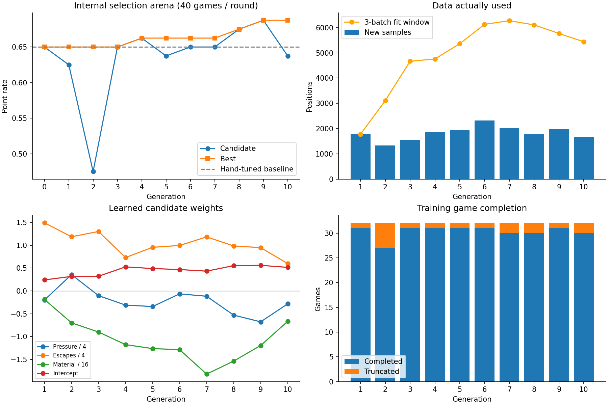
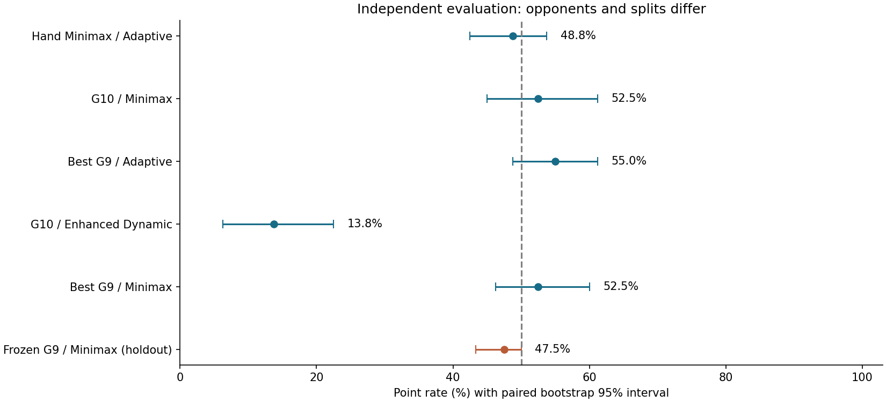

# Linear Self-play v1：训练验收与复盘报告

**实验日期：2026-11-25（Asia/Shanghai）**  
**代码版本：`00e9eccf16e1b4c985f849453699a003d39c76f5`**  
**状态：10轮训练、阶段对照和最终留出测试均完成。**

## 1. 结论与处理决定

本轮按方案完成1轮流程验证和10轮正式线性自博弈，没有修改规则、初始棋盘、评估特征、搜索实现或正式Bot默认设置。正式训练用时约19.48分钟，生成18,242个有效局面；内部历史Best为第9轮，55/80分，第10轮候选为51/80分。

冻结第9轮Best后，在全新30对开局上对原版Minimax完成60局：**0 / 57 / 3（胜/平/负），积分率47.50%，配对95%区间43.33%–50.00%**。最终留出区间未排除50%积分率，尚未证明比原版 Minimax 稳定更强。

不追加到30轮或50轮：Best对Adaptive相对手工基准的配对提升为6.25个百分点，95%区间为−1.25至15.00个百分点，包含零，未达到本次预先记录的条件续训标准。内部Best虽然更新，但不能把固定筛选集上的小幅提高直接视为泛化成功。正式Bot维持原版，冻结模型作为实验产物保留。

根据用户在运行中的明确选择，本轮只交付训练验收与报告，**六组增强搜索参数实验留到下一轮**；没有将准备好的命令计作已完成实验，也没有开发下一代Teacher流水线。

## 2. 环境、复现及数据隔离

- Windows 11，Python 3.13.7；AMD Ryzen 9 7940H，8核16线程。
- 训练前全部77项测试通过。线性训练只需标准库；画图使用本机已有Matplotlib，不属于模型运行依赖。
- 本次训练和正式计时对战串行运行，未同时运行其他训练任务。计时受实际机器负载和截止回退影响，不承诺跨机器逐步完全一致。
- 内部筛选：训练器Seed42生成10对开局，分别对Greedy、Minimax换边，每次40局。
- 外部独立评测：Seed31415、20对开局，每组40局；与内部开局无重复。
- 最终留出：先冻结模型，再用Seed27182生成30对开局，60局；与上述两套开局均无重复。见[划分审计](training/linear_v1_20261125/split_audit.json)。
- 从自定义开局对战时，重复历史按现有程序重新开始，未改变课程裁判规则。不同Seed不意味着所有后续局面互不重叠。

内部筛选用于更新Best，外部评测用于判断是否值得续训，最终留出不参与训练或模型选择。本轮没有重新挑种子、删掉失败局或根据留出结果重新训练。

## 3. 实际执行命令

以下命令均在`Tablut-AI/`运行。目录加日期以保护原有训练产物；已有文件不能直接覆盖。完整命令、退出码和耗时见[训练运行清单](training/linear_v1_20261125/manifest.json)及[评测运行清单](training/linear_v1_20261125/evaluation_manifest.json)。

```powershell
python -m unittest discover -s tests -q
git rev-parse HEAD
python scripts/generate_openings.py --pairs 20 --seed 31415 --output reports/experiments/linear_v1_20261125/selection_openings.json
python scripts/benchmark.py --strategy minimax --opponent adaptive --openings reports/experiments/linear_v1_20261125/selection_openings.json --output reports/experiments/linear_v1_20261125/baseline.json
python -u scripts/train_selfplay.py --iterations 1 --train-games 8 --eval-pairs 1 --max-plies 160 --output-dir reports/training/linear_v1_20261125/smoke
python -u scripts/train_selfplay.py --iterations 10 --train-games 32 --eval-pairs 10 --max-plies 160 --seed 42 --output-dir reports/training/linear_v1_20261125/formal
python -u reports/training/linear_v1_20261125/evaluate_run.py
```

阶段评测脚本只调用现有Benchmark，分别运行第10轮候选对Minimax、Best对Adaptive、第10轮候选对Enhanced Dynamic、Best对Minimax。没有接入未实现的策略。模型冻结后执行：

```powershell
python scripts/generate_openings.py --pairs 30 --seed 27182 --output reports/experiments/linear_v1_20261125/final_holdout.json
python scripts/benchmark.py --strategy minimax --model reports/training/linear_v1_20261125/frozen_model.json --opponent minimax --openings reports/experiments/linear_v1_20261125/final_holdout.json --output reports/experiments/linear_v1_20261125/frozen_best_holdout.json
```

## 4. 正式训练逐轮结果

配置为10轮×32局自博弈、每轮40局内部评测、160半步截断。第0轮另有40局内部基准，合计440局内部评测。本轮连同独立基准、Smoke评测、四组阶段对照和最终留出，共运行708局官方裁判对战，另有328次训练自博弈（含Smoke）。有限轮次模式使用岭回归，不是`--continuous`模式的混合/扰动优化。

| 轮次 | 本轮有效局面 | 实际拟合局面 | 截断局数 | 候选积分 | Best积分 | Best轮次 |
| --- | --- | --- | --- | --- | --- | --- |
| 0 | 0 | 0 | 0 | 52/80 | 52/80 | 0 |
| 1 | 1775 | 1775 | 1 | 50/80 | 52/80 | 0 |
| 2 | 1333 | 3108 | 5 | 38/80 | 52/80 | 0 |
| 3 | 1559 | 4667 | 1 | 52/80 | 52/80 | 0 |
| 4 | 1864 | 4756 | 1 | 53/80 | 53/80 | 4 |
| 5 | 1939 | 5362 | 1 | 51/80 | 53/80 | 4 |
| 6 | 2323 | 6126 | 1 | 52/80 | 53/80 | 4 |
| 7 | 2011 | 6273 | 2 | 52/80 | 53/80 | 4 |
| 8 | 1771 | 6105 | 2 | 54/80 | 54/80 | 8 |
| 9 | 1984 | 5766 | 1 | 55/80 | 55/80 | 9 |
| 10 | 1683 | 5438 | 2 | 51/80 | 55/80 | 9 |

320局自博弈的实际结果：攻方胜66、守方胜170、平局67、截断17；完成率94.69%，截断率5.31%。截断对局样本不参与拟合。

累计生成18,242个有效局面，但第10轮只用最近三批的5,438个局面拟合。不能把18,242解释为最后模型同时学习的样本量，也不能把局面数当作相互独立的训练案例。

流程验证另完成8局自博弈中的7局、截断1局，得到379个局面和两个检查点；候选在只有4局的小型评测中取得7/8分。这说明流程可运行，不是正式性能结论。



图中Best只在严格超过旧分数时更新；候选下降不会覆盖Best。第9轮55/80相对第0轮52/80只是内部积分率从65%升至68.75%，提高3.75个百分点。

## 5. 冻结模型与权重解释

选定模型为**第9轮Best**，来自`formal/checkpoint-0010.json`的`best`字段。`weights`非null，因此本轮Best对战确实加载了学习评估器。`candidate`字段则是第10轮模型，二者不能混用。

模型统一以守方视角计算`V = w1*(P/4) + w2*(E/4) + w3*(M/16) + b`，攻方取负。`P`为国王邻接攻方数，`E`为国王可直接到边缘的合法路线数，`M`的实际实现是`攻方数量−2×普通守方数量`，不是简单棋子总数相减；国王单独处理。

| 归一化特征 | 第9轮冻结权重 |
| --- | --- |
| P/4：国王包围压力 | -0.677530933 |
| E/4：国王直接逃生路线 | 0.946830294 |
| M/16：子力差 | -1.195110664 |
| 截距 | 0.559886564 |

手工守方评估在相同特征坐标上的系数为`(-400, 600, -160, 0)`，与回归的终局标签尺度不同，不能直接比较绝对大小。可比较相对比例：学习后的子力/逃生系数绝对比约为1.262，手工约为0.267，表明这份模型相对更强调子力特征。它是否有助于选择正确走法，必须由对战验证，不能只凭权重直觉断言。

冻结文件[ frozen_model.json ](training/linear_v1_20261125/frozen_model.json)保留所选记录和原检查点SHA256，去掉回放训练样本，便于加载。正式Bot不会自动使用此文件。

## 6. 独立对战与最终留出

采用2/1/0积分；积分率为`(2×胜+平)/(2×总局数)`，不是胜率。所有表格均以我方模型为视角。

| 实验 | 局数 | 胜 / 平 / 负 | 积分 | 积分率 | 配对95%区间 |
| --- | --- | --- | --- | --- | --- | --- |
| 手工 Minimax → Adaptive（独立基准） | 40 | 5 / 29 / 6 | 39/80 | 48.75% | 42.50%–53.75% |
| 第10轮候选 → 原版 Minimax | 40 | 7 / 28 / 5 | 42/80 | 52.50% | 45.00%–61.25% |
| Best第9轮 → Adaptive | 40 | 7 / 30 / 3 | 44/80 | 55.00% | 48.75%–61.25% |
| 第10轮候选 → Enhanced Dynamic | 40 | 2 / 7 / 31 | 11/80 | 13.75% | 6.25%–22.50% |
| Best第9轮 → 原版 Minimax | 40 | 7 / 28 / 5 | 42/80 | 52.50% | 46.25%–60.00% |
| 冻结Best第9轮 → Minimax（最终留出） | 60 | 0 / 57 / 3 | 57/120 | 47.50% | 43.33%–50.00% |



置信区间以开局为重采样单位，每个开局的攻守两局合并，固定Seed42重采样10,000次，使用百分位区间。20对或30对仍属小样本；该区间不是“胜出的概率”，也没有证明不同对手之间可直接横向排名。未对多个探索性比较做显著性校正，不能从中挑最高值作为正式晋级证据。

Best对Adaptive的点估计55%，区间48.75%–61.25%。与同开局手工基准做逐开局差值后，提升区间为−1.25至15.00个百分点，不能排除没有改善。第10轮候选对Minimax为52.5%，区间45.00%–61.25%。

### 攻守成绩与运行稳定性

| 实验 | 执攻 胜/平/负 | 执攻积分 | 执守 胜/平/负 | 执守积分 | 单方整局最高用时 |
| --- | --- | --- | --- | --- | --- |
| 手工Minimax / Adaptive | 1 / 15 / 4 | 17/ 40 | 4 / 14 / 2 | 22/ 40 | 7.044秒 |
| G10 / Minimax | 4 / 12 / 4 | 20/ 40 | 3 / 16 / 1 | 22/ 40 | 1.681秒 |
| Best G9 / Adaptive | 3 / 16 / 1 | 22/ 40 | 4 / 14 / 2 | 22/ 40 | 8.747秒 |
| G10 / Dynamic | 1 / 5 / 14 | 7/ 40 | 1 / 2 / 17 | 4/ 40 | 51.984秒 |
| Best G9 / Minimax | 3 / 14 / 3 | 20/ 40 | 4 / 14 / 2 | 22/ 40 | 1.683秒 |
| 冻结G9 / Minimax 留出 | 0 / 28 / 2 | 28/ 60 | 0 / 29 / 1 | 29/ 60 | 1.714秒 |

上述全部独立实验的非法走法、超时、异常均为0；内部筛选遇到这些问题会直接报错，本轮训练正常完成。具体责任方日志、非法返回和逐局时间在原始JSON中。当前这些对战没有开启逐步搜索统计，不能从结果声称每一步都完成了指定深度。原版Minimax目标深度为2，增强动态搜索使用默认最大深度4和现有时间控制。

### 留出测试的失败案例

60局中只有3局判负，分别如下；其余57局平局，没有获胜局。

| 对局编号 | 开局编号 | 我方角色 | 获胜方 | JSON半步数 |
| --- | --- | --- | --- | --- |
| 7 | 4 | 攻方 | 守方 | 40 |
| 8 | 4 | 守方 | 攻方 | 19 |
| 29 | 15 | 攻方 | 守方 | 24 |

开局4交换角色后两局都输，开局15攻方输、守方平；剩余28对开局均两局平局。三局单方累计用时均不足1秒，未发生超时、非法走法或异常，不能归因为耗尽60秒预算。记录仅含胜负和裁判日志，没有逐步棋谱，因此不能据此定位哪一步是战术失误；后续若需要行动级复盘，应另行记录完整棋谱，不能从汇总数据编造走法。

## 7. 训练质量与瓶颈复盘

1. **小型流程验证不能代表棋力。** Smoke的7/8分到正式内部Best的55/80分来自不同开局数；独立对手和留出测试又是另一套问题，不能拼接成一条持续进步曲线。
2. **内部Best有选择偏差。** 同一40局筛选集被10轮反复使用，Best单调不降是保存规则，并不自动意味着泛化能力单调提高。
3. **终局标签具有角色偏斜。** 正式自博弈守方胜170局、攻方胜66局、平67局。按局面统计的标签为{0: 2800, 1: 10638, -1: 4804}（−1攻胜、0平、+1守胜），长局会贡献更多样本。每局中的局面共享终局标签，存在相关性。
4. **数据策略与部署策略不同。** 训练前6半步随机、其后有10%随机探索；部署评测使用确定性的Minimax及真实截止时间。由探索轨迹学到的终局相关性未必直接改善确定性决策。
5. **三个特征表达能力有限。** 当前模型缺少国王距离边缘、通道封锁、潜在捕获等信息。岭回归能重新分配现有特征权重，不能从不存在的输入里学习新战术。
6. **拟合误差不是棋力指标。** [机器可读指标](linear_selfplay_20261125/metrics.json)记录滚动训练集MSE，它只描述对已见标签的拟合，没有被当作独立验证分数。不能将低训练MSE当作胜率提升。
7. **截断率需要观察，尚不构成大量失效。** 正式训练17/320局截断，约5.31%，已全部剔除。此次没有为追求更多样本中途修改160步上限或把截断当平局。

这些是由实现和本轮数据支持的限制与解释，不能据此断言某一个因素已经被证明是失败的唯一原因。没有进行特征消融或Teacher对照，因此不把相关现象说成因果结论。

## 8. 停止、后续建议与未执行内容

本轮先保留模型与数据，停止追加同配置训练。正式Bot保持原版，不根据内部Best分数自动晋级。若希望更强的参赛Bot，下一轮优先执行方案中的ED1–ED6增强动态搜索参数对照，再用全新开局验证选出的配置。

模型路线的后续工作应单独开发和验证：逐项增加可解释特征，接入Enhanced Dynamic教师，再研究学习评估与增强搜索结合。当前Enhanced策略拒绝`--model`，本轮没有偷偷接入或绕过参数校验。1100轮神经网络检查点未用于本实验，也没有启动新的神经训练。

| 计划内容 | 本轮状态 |
| --- | --- |
| 环境和20对独立基准 | 完成 |
| 1轮流程验证 | 完成 |
| 10轮×32局正式训练 | 完成 |
| Minimax / Adaptive / Enhanced Dynamic阶段验证 | 完成；另测Best对Minimax |
| 追加20轮或40轮 | 按条件停止，未执行 |
| 冻结模型后30对最终留出 | 完成 |
| ED1–ED6参数实验 | 用户明确选择留待下一轮，仅准备命令 |
| 扩展特征 / Teacher开发 | 后续研发，未开发 |
| 正式Assessment Bot切换 | 未进行 |

## 9. 文件与再次使用

| 产物 | 位置 |
| --- | --- |
| 本报告 | `reports/LINEAR_SELFPLAY_REVIEW_20261125.md` |
| 曲线、对战图、机器可读指标 | `reports/linear_selfplay_20261125/` |
| 正式0–10轮检查点 | `reports/training/linear_v1_20261125/formal/` |
| 精简冻结模型 | `reports/training/linear_v1_20261125/frozen_model.json` |
| 运行命令、日志、停止决定、划分审计 | `reports/training/linear_v1_20261125/` |
| 开局与逐局原始评测 | `reports/experiments/linear_v1_20261125/` |
| 完整训练复盘包 | [training_bundle.zip](training/linear_v1_20261125/training_bundle.zip) |

再次评测冻结模型可运行下列命令，请使用新的输出文件名：

```powershell
python scripts/benchmark.py --strategy minimax --model reports/training/linear_v1_20261125/frozen_model.json --opponent adaptive --games 2 --seed 100 --output reports/experiments/frozen_g9_new_run.json
```

训练目录受Git忽略；本轮实验子目录、报告和图表尚未纳入版本控制，均保存在本机，没有自动上传GitHub。报告附带SHA256和完整实验包便于另行归档。本轮没有提交或推送代码。
