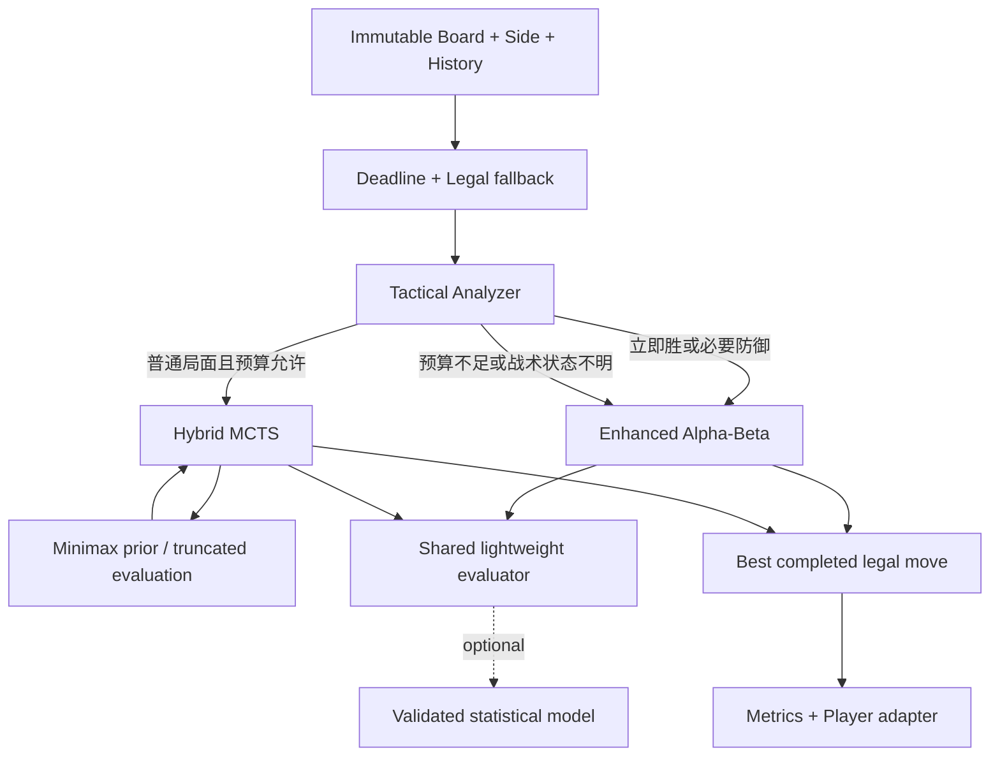

# Tablut-AI vNext：自适应战术混合搜索（ATHS）代码改造与训练实施方案

**文档性质：** 开发实施规格 / Code Change Plan（不是已完成的代码或实验报告）  
**制定日期：** 2026-11-25  
**目标仓库：** `king050611/computational_intelligence`  
**稳定基线：** `main@b51abfd09192698f3fc2e2650d913448f4406aec`  
**既有训练分支：** `feature/selfplay-neural-training@732f95fd0f26c5a88d5227e9da4a8e9a0a02cf3f`  
**建议新分支：** `feature/enhanced-search` → `feature/hybrid-search` → `feature/statistical-evaluator`  
**项目代号：** Adaptive Tactical Hybrid Search for Tablut (ATHS)，仅为拟议项目名称，不声称算法学术首创。

---

## 0. 执行摘要与不可违反的约束

### 0.1 最终选择

近期正式候选：Enhanced Alpha-Beta + Adaptive Time Management。研究候选：在增强 Alpha-Beta 基础上实现不依赖神经网络的 MCTS-Minimax Hybrid（从 IC-M 截断评估到 IP-M-k 节点先验），最后才试验根据战术风险切换搜索器的 ATHS。轻量统计学习用于可选的评估函数增强，不是前置条件。现有 Neural MCTS 暂停无限训练，保留为对照及可选后续修复实验。

**先做强、快、可解释的传统搜索，再验证混合搜索和学习是否真的有增益。** 不以更复杂、训练更多轮、显示更深的搜索层数作为成功标准。最终正式 Bot 选择实测胜者；若 ATHS 未超过增强 Alpha-Beta，就提交增强 Alpha-Beta，不强行组合。

### 0.2 当前代码事实与约束

- 课程裁判 `reference/Tablut.py` 每方整局累计 60 秒；默认安全余量 5 秒。当前 `TimeManager` 按预计 30 次行动均摊剩余预算。
- 棋盘 9×9，A 先行，D 控制普通守卫与 K。国王到任意边缘即胜、被捕获则 A 胜；A 少于 2 枚棋子也判 D 胜；重复 `(board, side)` 或无合法走法判和。**以项目官方裁判和已验证的 `src/game.py` 为准**，不是网上其他 Tablut 变种（例如四角逃生规则）。
- 现有 `choose_move` 默认 Minimax 深度 2；Adaptive 在危险局面、根分支数不超过 40 且时间足够（阈值 0.4 秒）时尝试深度 3。根节点已经有走法排序，递归内部没有完善排序/置换表；迭代未完成时保留上一次完整结果。
- `TeamXX.py` 正式入口 `Player(record_search=False)`、`play_attacker(board)`、`play_defender(board)`；返回 `[[r1,c1],[r2,c2]]`。保持接口和默认行为，直到所有上线门槛通过。
- 当前基线仅用 Python 标准库。原有测试文件有 46 个测试方法；历史文档称通过 46 项，但本方案未实际执行。新增算法的正式运行不得依赖 NumPy、模型文件、外网、GPU 或绝对路径。
- 1100+ 轮表现差是用户报告；本方案没有读取本地模型与曲线。远程训练代码默认 12 局/轮、16 simulations/步、1 轮价值预训练、3 epochs、24 隐藏单元、120 plies 上限；实际运行参数应从本地 `.npz` metadata 核对。

### 0.3 非目标（本轮不做）

不修改官方裁判，不替换规则，不重写整套 CLI/Replay，不复制第二套规则引擎，不直接合并神经网络分支，不引入 GPU/JAX/PyTorch 作为运行依赖，不声称完整复现 AlphaZero 或 Baier & Winands 的全部实验。不开启无上限的持续训练。不得用 force push、hard reset 或覆盖已有实验文件处理团队分支。

---

## 1. 总体架构与算法接口



各策略必须可单独运行，使用相同规则、计时器、统计格式与评估版本。ATHS 只在后期做策略路由；不要默认每一步同时完整运行 Alpha-Beta 和 MCTS。所有分支共享**同一个绝对 deadline**，不能重新计时获得额外预算。

| 策略标识 | 含义 | 首次加入阶段 |
|---|---|---|
| `first/random/greedy/minimax/adaptive` | 原有基线，行为保持不变 | 已有 |
| `enhanced` | 增强 Alpha-Beta，先用旧时间管理及旧评估 | P1 |
| `enhanced_dynamic` | enhanced + 动态时间管理 | P2 |
| `uct` | 不依赖网络的 UCT 基线 | P3 |
| `mcts_ic` | Minimax 截断评估 MCTS | P3 |
| `mcts_ip` | Minimax 虚拟访问先验 MCTS（不做 k 剪枝） | P3 |
| `mcts_ip_k` | 先验 + 排序 + 限宽候选 | P4 |
| `aths` | 战术路由 + 动态预算 + 经验证的混合搜索 | P4 |

建议统一新增入口（类型为接口规格，不是可直接运行的完整代码）：

```python
# src/experimental_search.py
from src.game import Board, Move

def choose_experimental_move(
    board: Board, side: str, *, strategy: str, deadline: float,
    history=(), evaluator=None, rng=None, stats=None, options=None,
):
    """Return Move or None if no legal moves. No I/O, no checkpoint loading."""
```

保留 `src/search.py` 既有 `choose_move` 签名；第一阶段不用修改它的算法主体。新增策略通过独立 dispatcher 调用。将实验策略注册集中在一个模块，CLI 的 choices 使用旧策略 + 新策略列表，避免把 `STRATEGIES` 直接扩展却让旧 `choose_move` 错误进入默认分支。旧策略仍走原路径；需要公用常量可直接导入。使用 Python 3.9 兼容写法，避免 `match`、`X | None` 等高版本语法，除非团队正式升级最低版本。

### 1.1 约定统一的数值视角

`evaluate(board, side)` 越大越有利于该 side。Alpha-Beta 使用固定 root_side，MAX/MIN 按当前走棋方是否等于 root_side。MCTS 统一使用 D 视角：D 胜 +1，A 胜 -1，和 0；D 节点最大化 Q，A 节点最大化 -Q。不要同时在回传时翻转符号。启发式值转换为 `tanh(score / scale)` 或经验证的 WDL 模型期望；终局直接返回精确 ±1/0。旧 Alpha-Beta 终局保留 `WIN_SCORE = 1e9`；绝不将其直接注入 MCTS 的 W。归一化 scale 使用调参集确定后冻结。不能把网络或统计输出当作证明胜负。

---

## 2. 文件级改造清单

以下均相对 `Tablut-AI/`，新增文件名是推荐设计，现有文件名来自实际仓库。

| 文件 | 操作 | 内容 / 责任 | 阶段 |
|---|---|---|---|
| `src/game.py`、`reference/Tablut.py` | 不修改 | 唯一规则与官方裁判 | 全程 |
| `TeamXX.py` | 默认不修改 | 稳定正式入口 | P0–P6 |
| `src/search.py` | 默认不修改 | 保留旧策略和 TimeManager | P0–P6 |
| `src/evaluation.py` | 保留 | 现有三特征 baseline | 全程 |
| `config/settings.py` | 保留原参数 | 不覆盖旧实验 | 全程 |
| `config/experimental.py` | 新增 | 各策略参数、开关、配置验证 | P1 |
| `src/enhanced_search.py` | 新增 | 递归 Alpha-Beta、迭代加深、PV | P1 |
| `src/transposition.py` | 新增 | 置换/排序提示表，分数缓存后置 | P1 |
| `src/tactics.py` | 新增 | 即时胜负、必要防御、风险检测 | P1/P2 |
| `src/time_control.py` | 新增 | 动态预算、soft/hard deadline | P2 |
| `src/mcts.py` | 新增 | UCT 节点、扩展、回传、截断 | P3 |
| `src/hybrid_search.py` | 新增 | Minimax prior、选择性扩展、ATHS 路由 | P3/P4 |
| `src/experimental_search.py` | 新增 | 实验策略注册、统一 dispatch | P1 |
| `src/experimental_player.py` | 新增 | 课程接口适配、历史维护、计时、stats | P1 |
| `src/features.py` | 新增 | 版本化轻量特征、D 视角、特征缓存 | P5 |
| `src/statistical_evaluator.py` | 新增 | JSON 权重加载、纯 Python 推理 | P5 |
| `scripts/benchmark.py` | 最小修改 | 统一 Bot factory、可选模型、策略对比、独立输出 | P1/P5 |
| `scripts/play_cli.py`、`scripts/replay_demo.py` | 最小修改（后置） | 显式选择新策略、保留旧默认及输出 | P4 |
| `scripts/replay_template.html` | 可选新增展示 | 区分深度与模拟次数，兼容旧 JSON | P4 |
| `scripts/generate_openings.py` | 新增 | 固定种子、合法开局集、角色配对 | P0 |
| `scripts/evaluate_positions.py` | 新增 | 战术题集、搜索等价性、吞吐测量 | P1 |
| `scripts/run_experiments.py` | 新增 | 批量配对实验、结果归档、manifest | P0/P1 |
| `scripts/generate_training_data.py` | 新增 | Teacher 棋谱/标签、数据集 manifest | P5 |
| `scripts/train_statistical.py` | 新增 | 岭回归/逻辑回归训练、版本化保存 | P5 |
| `scripts/evaluate_checkpoints.py` | 新增（训练分支单独实现） | 历史神经网络分析、模拟预算扫描 | P0 |
| `tests/test_enhanced_search.py`、`test_transposition.py`、`test_tactics.py` | 新增 | 规则一致性、搜索正确性 | P1 |
| `tests/test_time_control.py`、`test_mcts.py`、`test_hybrid_search.py` | 新增 | 计时、视角、合法性、回退 | P2–P4 |
| `tests/test_statistical.py`、`test_experiments.py` | 新增 | 数据划分、模型 I/O、实验可复现 | P5 |
| `requirements.txt` | 保留 | 标准库运行 | 全程 |
| `requirements-training.txt` | 可选新增 | 仅离线训练使用的经验证依赖 | P5 |
| `docs/ALGORITHM_DESIGN.md`、`docs/TRAINING_GUIDE.md` | 新增 | 设计说明、训练及复现实验 | P1/P5 |
| `.gitignore` | 最小修改 | 忽略大规模数据/模型/训练日志 | P0/P5 |

新增 `reports/experiments/aths/`、`reports/training/statistical/`、`data/generated/`（运行时创建，不提交大量生成物）；提交小型可复现测试 fixture、配置、数据 schema、报告索引。必要模型文件经审核可作为小型正式工件单独提交，且默认入口仍具备无模型回退。

---

## 3. P0 — 冻结原版和 1100+ 轮实验

### 3.1 Git 操作（PowerShell，仓库根目录）

```powershell
git status --short
git fetch origin
git switch main
git pull --ff-only origin main
git rev-parse HEAD
git branch backup/main-before-aths
git push origin backup/main-before-aths
git switch -c feature/enhanced-search main
```

若 main 已变化，先审查新差异并更新基线 SHA；备份分支名若已存在需另取名。`feature/selfplay-neural-training` 保持独立，不 cherry-pick 整个提交。用独立 worktree/clone 分离实验和训练目录，避免训练进程被切分支影响；先备份未跟踪检查点并确认停止。当前训练脚本默认目录 `reports/training/neural/`，如使用自定义路径必须对应实际路径：

```powershell
# 在现有训练分支、Tablut-AI 目录的另一个终端运行
New-Item -ItemType File -Path 'reports/training/neural/STOP'
```

等当前轮保存并正常退出后，复制整个 run 目录（含全部 `.npz`、日志、reference JSON 如有）到独立备份。记录检查点 SHA256、训练配置、代码 SHA、机器型号、Python/NumPy 版本。不要只留 latest；保留历史 best 指向的 checkpoint。不要把 STOP 文件带入新训练 run。不要将训练目录随意 `git add -f`。

### 3.2 记录 baseline

```powershell
cd Tablut-AI
python -m unittest discover -s tests -v
python scripts/benchmark.py --strategy adaptive --opponent random --games 10 --seed 42 --output reports/experiments/baseline_adaptive_random_s42.json
python scripts/benchmark.py --strategy adaptive --opponent minimax --games 10 --seed 42 --output reports/experiments/baseline_adaptive_minimax_s42.json
```

现有 benchmark 默认从固定初始局面开局，改 seed 并不能保证确定性策略获得不同棋谱。上面只是 smoke baseline；正式比较必须新增多开局配对框架（第 10 节）。

### 3.3 神经网络诊断，不再盲目增加轮数

从实际 checkpoint metadata 读取 `config`、`phase`、`best`、`loss`、`training_games`、`samples`、`evaluation`；按轮次画 Value MSE / Policy CE / selection 积分 / 完成及截断率；检查 A/D 的样本和胜率，注意 Value 阶段无 Policy CE。取实际存在的 1、100、300、500、1000、latest 和历史 best（去重），与原版 minimax/adaptive 在独立开局攻守配对。

额外诊断同一模型的 16/32/64/128 simulations（仅在单步或整局预算允许时），区分固定模拟预算和固定时间预算。当前 benchmark 按 checkpoint config 取 simulations，没有覆盖参数；需在训练分支新增 `--simulations-override` 或单独诊断脚本，不能假装旧参数存在。另做立即胜/必须防守战术题集。模型可能因浅搜索、弱策略标签、无跨轮 replay、共享小网络等而失败；这些属于待验证假设，不是已经查明的故障原因。

---

## 4. P1 — Enhanced Alpha-Beta：第一优先级

### 4.1 性能分析先行

先测 `get_legal_moves`、`apply_move`、`check_winner`、`_features` 耗时和节点展开比例。当前 `apply_move` 会重新枚举合法走法进行校验，`check_winner` 可能枚举合法走法，旧评估也会枚举 D 走法判断直接逃生。优先在搜索局部复用已计算结果（每次搜索内缓存，不改变公开规则）；不要立即删除合法性校验。若后续新增内部 trusted apply 快速路径，必须单独 PR，与公开规则函数在大量可达棋局/所有合法走法上做逐项差分测试，且正式返回前仍校验合法性。P1 不将此风险较高的规则重构作为必做项。

### 4.2 搜索流程及回退

```python
# conceptual pseudocode
moves = get_legal_moves(board, side)
if not moves:
    return None
best = moves[0]                    # legal fallback established first
for depth in range(1, max_depth + 1):
    if soft_deadline_reached():
        break
    try:
        candidate, score, pv = search_root(board, side, depth, hard_deadline)
    except SearchTimeout:
        break                      # discard incomplete depth
    best = candidate
    publish_completed_iteration(depth, score, pv)
    if proven_terminal(score):
        break
return best
```

- `max_depth` 初始建议 4（调参 3/4/5），不是保证每步完成；同一 deadline 下让算法有机会比原版深度 2/3 更深。每层/昂贵操作前后检查时间；最深未完成层不可伪装成完成深度。
- P1a 仅替换搜索实现，固定深度 2/3、旧评估、旧时间管理，与旧版逐节点对比分数。相同分数的走法允许不同；确定性测试使用固定 tie-break 规则（例如原合法走法顺序），检查最优动作集合。
- P1b 再开启完整迭代加深。复用上一层 PV 第一走法；未来可引入 PVS/aspiration，但先不做，避免 re-search 与浮点窗口错误。
- 搜索节点先做终局判断，再评估深度 0；通过 `history + ancestor_keys` 处理重复，历史不得包含待判定的当前局面。每个节点只增加实际访问计数，不把缓存命中当完整展开。

### 4.3 递归走法排序（不剪掉合法动作）

排序优先级：立即终局胜、PV/TT hint、必要防御（已确认）、捕获、关键通道动作、killer/history、原稳定顺序。先启用低成本 PV/TT + 捕获信息；只有局面风险高且时间允许才计算昂贵战术等级。避免对每个 child 反复完整枚举对手所有走法、全量排序造成吞吐下降。P1 必须保留所有合法分支，不用 top-k 冒充精确 Minimax。

`killer[ply]` 保存每层最近导致 beta cutoff 的非捕获走法，`history_score[(side, move)] += depth**2`（可衰减），仅作排序。置换表/历史提示若不是当前合法走法直接忽略。排序不可改变完整固定深度 Minimax 值；每项独立测开关（ablation）。

### 4.4 Transposition Table（TT）：分两级交付

本项目重复规则使相同棋盘在不同历史路径上有不同价值。**最低风险首先仅做 best-move hint**，即使历史不同也只改变排序，不直接复用结果。

```python
# src/transposition.py — interface sketch
@dataclass
class TTEntry:
    depth: int
    best_move: Optional[Move]
    score: Optional[float] = None
    bound: Optional[str] = None   # EXACT / LOWER / UPPER
```

初始 key 使用不可变 `(board, side)`，每个搜索/每局独立、有容量上限（建议先 20k entries，再压测）；不急于 Zobrist。分数缓存默认关闭。P1c 若做严格分数缓存，key 加上固定根视角、评估版本、完整相关历史集合（当前规则重复一次即和，可用精确 `frozenset(history)`，如规则改变需调整）及战术延伸上下文；碰撞时不能误判。仅当 entry.depth ≥ requested depth 且上下文匹配才考虑边界复用；固定深度等价性测试应只复用同深度或明确约定 deeper-search 语义。对 EXACT 直接返回；LOWER 更新 alpha；UPPER 更新 beta；`alpha >= beta` 才截止。存储依据调用前窗口 `alpha_original/beta_original`；被 timeout 打断的节点不得标记 EXACT。先进行跨历史反例及随机局面对照，缓存收益不明显则停留 hint 模式。

### 4.5 战术检测与延伸

`src/tactics.py` 返回 `TacticalInfo`：`immediate_wins`、`opponent_threat_now`、`safe_replies`、`status_complete`、`risk_level`。利用 `check_winner(apply_move(...), next_side, path)` 确认即时终局；不能用“国王旁边有 2 个攻方”直接当必杀（城堡规则不同）。对必要防守扫描我方候选及对手所有立即获胜回复；只有完整扫描才能证明候选安全；中途超时标记未知，不把未扫描动作判为失败。若已找到即时胜可返回；否则先保留已有合法回退。无安全回复不等于已经证明所有未来必输；只有搜索证明时才标终局。

P1d 可在深度 0 的不稳定局面进行受限战术延伸：只考虑规则确认的强制战术动作或必要防御，max extension 初值 1 ply，每路径独立计数、deadline 约束。不默认启用；单独比较 horizon effect 与吞吐损失。为了不漏掉防守，不能以仅枚举捕获动作的 quiescence 作为所有威胁局面的完整求解。若处于强制防御且无法完整识别，退回普通搜索。

### 4.6 P1 验收

无 NumPy 环境旧 46 项通过；新旧固定深度分数在战术局面和至少 100 个可达状态上等价（允许同分走法不同）；超时后返回合法动作且统计可信；记录同深度节点数、壁钟时间、NPS、完成深度；必须报告性能退化样本。若排序/TT 增加开销而没有提升，撤销对应开关或提交，不强制保留。

---

## 5. P2 — Adaptive Time Management

### 5.1 预算公式与保护

`src/time_control.py` 实现独立 `AdaptiveTimeManager`，旧 TimeManager 不动。创建一次/每 Bot/每局，统计真实 `perf_counter` 壁钟累计时间，包含解析、风险检测、搜索、合法性检查、返回格式转换。不要只计搜索递归。官方裁判计时仍是最终依据。进入 `_play` 时记录 start，任何异常 `finally` 均记耗时。

```text
available = max(0, 60 - 5 - spent)
remaining_moves = clamp(estimated_remaining_own_turns, 5, 40)
base = available / remaining_moves
complexity = 0.6 (easy) / 1.0 (normal) / 1.6 (critical)
allocation = min(available, base * complexity, 0.20 * available, 4.0)
hard_deadline = start + allocation
soft_deadline = start + 0.80 * allocation
```

这些是初始建议超参数，不是已验证最优值。以自身剩余行动次数计，不把双方 plies 当自己的行动。初期以 `max(8, 30 - own_turns//2)` 作简单预测，再利用训练/调参棋谱估计条件剩余步数；额外 20% 及 4 秒封顶需实验。预算为 0 时只走合法回退，不尝试深搜。注意合法走法枚举本身有成本，任何纯 Python 软 deadline 不能绝对保证进程被抢占时不超时，因此保留充足安全余量、检查实际裁判时间。避免为扫描复杂度重新开启时钟。简单局面/唯一合法动作/即时胜可提前返回；未完成迭代不要使用。

### 5.2 MCTS 的动态停止（P3 接入）

每完成一批模拟（初始 8 或 16）测吞吐，估计剩余可完成模拟量 `R`，若根节点第一名访问数减第二名访问数 `> R`，在访问计数每次只给一个根动作 +1、且估计 R 不低估的假设下可以提前停止；现实吞吐会波动，先加安全系数（如 1.5），因此视为启发式而非严格数学保证。虚拟先验计数与真实访问数分离，早停用真实访问；先要求最低模拟次数（例如 32），若预算不足则不承诺达到阈值。只有一个合法动作可立即选定。比较候选在分数/访问上接近时的额外搜索收益。纯 Alpha-Beta 依据完成层、终局证明、PV 稳定性/分数差变化提前停（仅启发式，不能宣称证明最优）。

### 5.3 计时消融

`enhanced` vs `enhanced_dynamic` 保持其余设置完全相同，报告关键局面用时、开中残局时间占比、总耗时和 timeout。进阶可对照固定的阶段时间分布（相同总体分配、无局面风险判别），参考 Baier & Winands (2016) 的 DISTRIBUTION 思路，区分时间偏移与动态判断效果。

---

## 6. P3 — 不依赖神经网络的 UCT 与 Minimax Hybrid

### 6.1 UCT 基线

`src/mcts.py` 新增独立实现，不从 `src/neural_player.py` 直接 import（避免 NumPy 与旧训练逻辑）。可参考其树结构，不能把现有 PUCT 当作标准 UCT。建议接口：

```python
@dataclass
class Edge:
    move: Move
    child: Optional[object] = None
    visits: int = 0           # real completed simulations
    value_sum: float = 0.0    # defender perspective
    prior_visits: float = 0.0
    prior_value: float = 0.0  # sum of virtual defender returns
```

UCT 选择分数：

`sign(side) * Q + C * sqrt(log(max(1, N_parent)) / N_edge)`，其中 sign(D)=+1、sign(A)=-1，Q 为 D 视角均值。未访问动作优先扩展（随机但可复现），纯 UCT 没有虚拟先验。C 初始 `sqrt(2)` 仅为起点，对 [-1,1] 值域在调参集扫描 0.5/1.0/1.4/2.0；不直接沿用神经 PUCT 的常数。每次模拟的 path 持有历史集合，终局由 `check_winner` 判断，回传只在完整模拟时增加真实计数。根终局无正常动作时返回 None；未完成任何模拟时回退合法走法。树内不复用不同历史的节点（先不做图搜索）。

基础 UCT rollout 采用可复现随机合法动作，设置最大 rollout plies（先 16/32/64 调参）和同一 hard deadline；自然终局给 ±1/0；到截断点的基本版本可设 0 并明确报告，另提供 `uct_eval` 使用静态归一化评估。不得把截断当真实和棋数据标签。固定种子下使用 `random.Random(seed)`；实战时间终止可能使棋谱不完全复现，另保留固定模拟次数的诊断模式（仍受安全 deadline）。

### 6.2 MCTS-IC-M：截断 Minimax

先在 UCT 的 rollout 截断时用浅层 Alpha-Beta 估计叶节点（depth 1 或 2），固定根 D 视角，包含当前搜索路径历史。此评估不能无限递归，使用当前 global deadline 和子预算；如果未完成目标深度，使用已完成的浅层值或静态估值，明确记录 fallback。终局不调用 Minimax。与 `uct_eval` 使用相同 rollout 深度做对照。优化实验使用 `max_rollout_plies` 4/8/16 和 minmax_depth 1/2；如果每次 Minimax 降低模拟吞吐过多，减少调用次数或放弃该变体。

### 6.3 MCTS-IP-M：虚拟先验注入

达到访问阈值 `n` 时，对对应子节点调用一次浅层 Alpha-Beta 得到归一化 D 视角 `h`。记录 `prior_visits += gamma`、`prior_value += gamma*h`；不能覆盖真实统计，也不反复对同一节点无限注入。计算选择时 `N_eff = N_real + N_prior`，`Q_eff = (W_real + W_prior)/N_eff`，父节点探索项使用同一口径的子边有效访问总和。尚未有真实访问的候选仍需被探索（例如独立 unvisited 分支机制）。根最终选取真实 visits 最多的动作（同分按均值、稳定顺序），先验不直接冒充实测访问量。

先验操作发生在 rollout 外的节点评估处；不得把虚拟计数加进整条真实回传路径。子搜索若没有完整目标深度，不注入该先验（可记录 skipped）。同一 simulation 的 deadline 到期后不增加真实统计；可保留已完整获得且合法的 prior，但需保证最终只选择已有合法回退或真实模拟结果。初始参数建议 `n=4`、`gamma=2`、`depth=1`；调参 `n={2,4,8}`、`gamma={1,2,4}`、`depth={1,2}`，单步先验预算最多约 30%，未到阈值不调用。不要跑全笛卡尔积，先单因素或小规模逐步淘汰。论文 IP-M 的 MCTS-Solver 及具体初始化机制未完整复现时，报告称“受 IP-M 启发的变体”。

### 6.4 终局证明（可选）

普通 MCTS 的均值不等价于 Minimax 证明。后续若实现 MCTS-Solver：仅当存在当前方已证明获胜的合法子节点才证明该方赢；所有合法子节点已展开且证明对手赢才证明输；无获胜、全部已求解且至少一和才证明和。部分扩展/k-best 情况不能由少数子节点推断全局输/和。先完成 UCT、IC-M、IP-M 之后再考虑 solver，不让额外复杂度阻断核心计划。

## 7. P4 — MCTS-IP-M-k 与 ATHS 路由

### 7.1 k-best 选择性扩展

对所有合法候选先做低成本排序；建议初始 k=8，调参 4/8/12/16。`k` 是普通候选数量，不是强制总上限。已确认的立即获胜动作、必要安全防御动作和 PV 提示不得仅因排名低被删除。无法完成防御扫描时禁止声称候选安全，回退 enhanced 或保留全合法动作。推荐渐进扩展而非永久裁剪：例如 `allowed = min(total, k + floor(sqrt(real_visits)))`，先扩展高优先级，再按访问次数放开其余动作。这个机制是本项目拟议变体，不等同于原论文的 k-best。必须分别对比 `mcts_ip`、固定 k、渐进 k，记录根节点覆盖率、被筛掉的已知最优动作数量和战术错误。

### 7.2 ATHS 的路由与共同 deadline

```python
# src/hybrid_search.py — pseudocode
moves = legal_moves(board, side)
if not moves:
    return None
fallback = moves[0]
info = analyze_tactics(board, side, history, deadline=tactical_subdeadline)
if info.immediate_wins:
    return info.immediate_wins[0]
if not info.status_complete or info.risk_level == 'critical':
    return enhanced_search(board, side, deadline=hard_deadline, history=history)
if insufficient_budget_for_hybrid() or len(moves) <= small_branch_threshold:
    return enhanced_search(board, side, deadline=hard_deadline, history=history)
return hybrid_mcts(board, side, deadline=hard_deadline, history=history,
                   fallback=fallback, options=validated_options)
```

初始阈值：根分支 ≤ 12、剩余单步预算 < 0.25 秒则优先增强 Alpha-Beta；风险分析用时不超过单步预算的约 10%（所有数值需调参）。当预算太低，不必完成昂贵风险扫描；直接进入 enhanced 回退。可先用一个完成的 greedy/浅层搜索结果建立更好的 fallback，但其耗时同样计入 deadline。只有在完成安全检查且不消耗剩余预算时才选择混合路径。

正式算法不硬编码“普通局面 MCTS 一定更好”；如果实验发现 MCTS 在多数普通局面也弱于 enhanced，则禁用路由或只在已验证分布使用它。实验应独立对比永远 enhanced、永远 hybrid 与 ATHS，控制时间管理和评估一致，防止因路由增加复杂度而丢失棋力。

### 7.3 Bot factory 与显示兼容

新增 `make_bot(strategy, seed, record_search=False, *, model_path=None, options=None)`：旧 `adaptive` 返回 `Player()`；其余旧策略返回 `StrategyBot`；新策略返回 `ExperimentalPlayer`。为避免 import cycle，可把 factory 放在 `scripts/benchmark.py`，由 CLI/Replay 复用，或将 StrategyBot 和 factory 迁移到独立模块并保留原 import 的兼容导出（分开 PR）。旧默认选项、原有 benchmark JSON 字段和外部 Bot 隔离机制保持一致。

`ExperimentalPlayer` 每局新实例；维护实际局面历史：A 首次调用前 history 为空，D 首次调用要记录实际开局 A 走棋状态（非初始开局时通过构造参数传入真实 opening）。每次接收当前 board 后，搜索传入已发生的历史；返回合法 move 后记录当前状态与 apply_move 后轮到对方的状态。下次调用不能把当前状态提前作为历史（避免假重复）。外部 Bot 接口只传当前棋盘，无法得知自定义开局的全部前史时必须明确限制；实验框架应传入真实 opening 和必要历史。对固定开局后重置历史的实验需注明规则约定，不能与带前史开局混用。

新增统计字段（均可空，旧字段不删）：

```json
{
  "strategy": "aths",
  "backend": "enhanced",
  "route_reason": "critical_tactics",
  "completed_depth": 3,
  "target_depth": 4,
  "nodes": 1250,
  "timed_out": true,
  "fallback_used": true,
  "budget_seconds": 1.2,
  "elapsed_seconds": 1.05,
  "remaining_seconds": 42.3,
  "tt_hint_hits": 14,
  "tt_score_hits": 0,
  "beta_cutoffs": 87,
  "simulations": null,
  "prior_calls": null,
  "root_coverage": null,
  "finish_reason": "search_deadline"
}
```

上例只是 schema 示例，不是实测。MCTS 的 `completed_depth`、`target_depth` 设为 null（如旧前端不接受，先修改前端 null 处理），不要以模拟次数伪造 Minimax 深度。新增 `simulations`、`rollout_steps`、`prior_calls`、`prior_seconds`、`root_coverage`、`expanded_nodes`、`real_root_visits`；共享 `nodes` 的统计定义应明确，跨算法不能直接按 NPS 判定优劣。Replay 保留旧 `search` 对象及缺失字段回退，旧 JSON 继续能打开；只有显式选择新策略才展示新字段。

---

## 8. P5 — 后续如何训练：轻量统计评估器（推荐学习路线）

### 8.1 训练目标与顺序

**增强 Alpha-Beta 和混合搜索本身不需要训练。** 训练的对象是轻量局面评估器，用来改善搜索的叶节点评分，而不是直接学习整套动作策略。顺序：先固定一个经验证的增强搜索 Teacher → 生成训练数据 → 拟合评估权重 → 在相同深度和相同时间下独立验证 → 合格才接入搜索。允许不采用机器学习模型作为最终结论。

对照两条学习路线：

- L0：旧手工三特征（baseline），不训练。
- L1：扩展特征 + 监督学习拟合 Teacher 排序/分数（首选，训练快、标签较密集）。
- L2：扩展特征 + 真实终局胜平负（岭回归或多项逻辑回归），用于校准实际期望收益。仅完成且合法的对局生成终局标签。
- L3：Teacher 标签与终局标签的混合目标（后续可选，标签都存在时才混合；不能把截断伪装成和棋）。

### 8.2 特征设计（`src/features.py`）

先用 8–12 个计算便宜且可解释的特征，分阶段增加。统一 D 视角，明确归一化和符号；A 取负值。特征版本 `tablut_features_v1`，顺序固定，输出 tuple，单独测试镜像/旋转及极端棋局。边缘逃生规则必须正确。

| 特征 | 示例定义（D 视角） | 预期作用 | 成本策略 |
|---|---|---|---|
| `attacker_count` | A 数 / 16 | 攻方资源 | 单次棋盘扫描 |
| `defender_count` | D 数 / 8（不含 K） | 守卫资源 | 同上 |
| `king_pressure` | 相邻 A 数 / 4 | 国王危险 | O(1) |
| `king_edge_distance` | min(r,c,8-r,8-c)/4 | 逃生距离 | O(1) |
| `king_escape_routes` | 国王可直达边缘走法数，按最多 4 方向归一 | 即时逃生潜力 | 共用合法动作结果 |
| `king_mobility` | K 合法走法数 / 16 | 活动空间 | 共用合法动作结果 |
| `attacker_mobility` | A 合法走法数，按固定常数或 train 标准化 | 攻方控制能力 | 可选，先测耗时 |
| `defender_mobility` | D/K 合法走法数，按固定常数或 train 标准化 | 守方活动能力 | 可选 |
| `blocked_king_rays` | 被 A 阻挡的国王四方向射线数 / 4 | 封锁程度 | 短射线扫描 |
| `nearby_defenders` | K 曼哈顿距离 ≤ 2 内 D 数 / 8 | 局部支持 | 同一棋盘扫描 |
| `game_phase` | (A+D)/24 | 棋局阶段 | 同上 |
| `side_to_move` | D=+1、A=-1 | 行棋优势 | 常数 |

如引入 side_to_move，评估接口必须显式区分 `current_side` 和 `root_side`，不可用 root_side 冒充当前走棋方；因此初版可不启用此特征，或使用专用 `position_value(board, current_side)` 返回 D 视角。动态阶段交互项（phase × material 等）后置；不先做昂贵的多步可达性或完整捕获扫描。合法动作缓存需包含 board+side，不能缓存依赖历史的终局分数。测试手工评估与学习评估终局处理始终由规则层优先。

### 8.3 数据生成（离线，不受实战每局 60 秒训练预算限制）

在训练集 seed 下用 Teacher、原版 Adaptive、Minimax、Greedy、少量随机探索与冻结历史候选对战，攻守互换；开局由官方合法动作走偶数 plies，排除终局/重复开局。建议初期 100–300 局试运行，每局从不同棋局阶段抽 8–20 个代表状态；之后扩至 500–2,000 局，规模由数据质量和机器能力决定，而非固定训练轮数。不同棋局的所有样本、同源对称增强及同一开局的角色交换对局必须落在同一划分，避免泄漏。训练数据生成允许离线固定深度 3/4 的 Teacher 或独立每局面计算预算，不强迫每个位置都完成 4 层；记录实际深度，只收满足最低要求的 Teacher 标签。生成时限制每个状态/每局时间，终止可恢复。

每个样本记录（JSONL，建议按 game 分 shard）：

```json
{"schema_version":1,"feature_version":"tablut_features_v1","game_id":"g0001","opening_id":"o0001","ply":14,"board":["...AAA...","....A....","....D....","A...D...A","AADDKDDAA","A...D...A","....D....","....A....","...AAA..."],"side":"A","features":[],"teacher_score_D":0.0,"teacher_depth":3,"teacher_completed":true,"outcome_D":null,"truncated":false,"source":"enhanced","seed":42}
```

这是格式示例而非真实棋谱：实际 ply、board、features、历史和结果必须由合法对局生成；`features` 必须与 schema 长度一致。若保留局面用于 teacher 重新搜索，应保存原始历史状态或完整可重放棋谱。Teacher 终局分数规范到 ±1/0，非终局分数 `tanh(score/scale)`；scale 从训练/验证集确定后写入 metadata。真实结果 A=-1,D=+1,DRAW=0；截断 `outcome_D=null`，可以保留可靠 teacher 标签，不能当 0。异常/非法走法产生的样本全部隔离。按来源、走棋方、胜负、阶段统计样本量；限制单一长局贡献，避免数据只覆盖强势方容易赢的局面。

### 8.4 划分、损失及模型训练

按 opening/game group 划分 train/validation/test 约 70/15/15（以独立组而非样本为单位），建立固定 manifest。最终对战 test openings 与训练、验证开局完全分离。可在 train 内做四重旋转增强，但必须验证规则旋转不变性、棋谱历史同步旋转；不混用四角逃生数据。标准化均值方差只从 train 拟合，零方差特征使用安全尺度。权重拟合从岭回归开始：

```
X = standardized_train_features_with_intercept
loss(w) = mean((X @ w - y)**2) + lambda * ||w_non_intercept||²
```

岭回归初始 `lambda = {0.001, 0.01, 0.1, 1}`（定义为平均损失的正则项），用正规方程/稳定求解器训练；NumPy 只在离线训练环境安装即可，也可沿用旧 `src/learning.py` 的小矩阵思路，但不要把仅支持 4 个系数的函数直接用于 N 维特征。截距不正则化，记录标准化方式。模型推理只需 Python `math.fsum`、tanh 或 clip；若 Teacher 标签已经为 [-1,1]，训练直接拟合该空间，推理用 clip 避免二次 tanh 改变校准。可选逻辑回归采用三分类 W/D/L softmax（输出 `p_D - p_A`），或明确二分类只拟合非和棋及其适用范围；不能简单将三分类的和棋解释为二分类标签。用 MAE/MSE、排序一致性、WDL log-loss/Brier（仅对概率模型）、各角色误差与每次评估耗时筛选。

### 8.5 轻量模型文件与推理

JSON checkpoint 示例（权重必须训练产生，以下仅示意结构）：

```json
{
  "schema_version": 1,
  "feature_version": "tablut_features_v1",
  "feature_names": ["attacker_count", "defender_count"],
  "mean": [0.0, 0.0],
  "scale": [1.0, 1.0],
  "weights": [0.0, 0.0],
  "bias": 0.0,
  "target": "teacher_value_D",
  "dataset_manifest_sha256": "<actual digest>",
  "teacher_commit": "<actual sha>",
  "train_config": {"regularization": 0.01, "seed": 42},
  "validation_metrics": {}
}
```

生产 loader 要验证 schema、特征顺序/长度、所有数字有限、scale>0、训练目标和版本匹配；示例的两特征不能通过完整 v1 schema。禁止 pickle、禁止运行文件内代码；模型只在 Bot 初始化/实验命令解析时加载一次，不每步读磁盘。显式指定坏模型应报错并使实验失败（不可静默回退导致假模型结果）；正式默认 Bot 不读模型，若未来正式模型启用应提供明确、可监控的无模型回退。

### 8.6 拟新增训练命令（实现后方可运行）

以下 CLI 是开发规格，不是现有仓库已支持的命令；开发者须实现 `--help` 和参数校验。

```powershell
# 1. 生成数据（试运行）
python scripts/generate_training_data.py --teacher enhanced --games 100 --teacher-depth 3 --seed 42 --output-dir data/generated/stat_v1
# 2. 固定划分并训练
python scripts/train_statistical.py --data-dir data/generated/stat_v1 --target teacher --regularization 0.01 --seed 42 --output-dir reports/training/statistical/run01
# 3. 在调参集比较旧评估与新评估，使用相同搜索与时间配置
python scripts/run_experiments.py --strategy enhanced_dynamic --model reports/training/statistical/run01/best.json --opponent enhanced_dynamic --openings data/openings/validation.json --output-dir reports/experiments/aths/stat_validation
# 4. 冻结候选，使用未见测试集评估
python scripts/run_experiments.py --strategy enhanced_dynamic --model reports/training/statistical/run01/best.json --opponent enhanced_dynamic --openings data/openings/test.json --output-dir reports/experiments/aths/stat_test
```

`--model` 仅作用于指定的我方模型，opponent 默认旧评估；需记录实际使用的 evaluator。训练目录包含 dataset manifest、train_config.json、candidate.json、best.json、metrics.json、日志和数据/模型 SHA；原子保存（临时文件 + 同目录替换，禁止覆盖已存在 run，resume 显式校验）。小规模岭回归无需每轮不断自博弈，可一次拟合多个正则参数。只有通过验证的候选才进入正式棋力测试；使用测试集一次性评估，不能根据 test 反复调参。

### 8.7 可选迭代学习（仅在监督训练有效后）

第 0 代 = 现有手工评估，第 1 代 = Teacher 蒸馏模型。每代混合约 50% Teacher/基线对局、25% 当前 best 自博弈、25% 历史 best 对局（角色均衡，比例为初始建议）；保持跨代 replay 与旧样本。优先使用固定数据集累计式训练，保留稀有战术局面；每代重新拟合或 warm start，固定验证集；候选仅当成对积分/稳定性达到预设阈值才晋升，否则下一代继续使用 incumbent best 生成数据，而不是无条件用弱 candidate 生成。建议先 3–5 代，连续 3 代无验证增益则停止，保留 best。每代保存学习曲线、标签分布、角色胜率与样本覆盖率。目标是棋力，不是持续训练本身。

---

## 9. 可选 P6 — 如果未来确实需要重新训练神经网络

本阶段不是 ATHS 必做任务，应在独立训练分支完成；先用第 3.3 节诊断确定瓶颈。现有 1100+ 检查点不可与修改后的模型 schema 混用，不直接覆盖旧目录。

| 优先级 | 训练修改 | 验证标准 |
|---|---|---|
| N0 | 复查棋盘编码、动作 ID、D 视角回传、终局、重复历史、合法 mask | A/D 战术题及固定种子对局正确 |
| N1 | 同 checkpoint 扫 simulations 16/32/64/128 | 固定时间/模拟预算两种性能曲线；不自动提高训练预算 |
| N2 | Teacher 监督预训练 Value + Policy；Teacher 的根候选分数或最优动作分布作标签 | 独立验证集价值误差、走法排序与战术正确率改善 |
| N3 | 神经训练使用 8–16 代或按样本上限的 replay buffer，混合旧/新与历史对手，按 A/D 平衡采样 | 降低遗忘、提升独立配对胜率 |
| N4 | 学习率搜索/衰减、正则、梯度检查和早停；保留 best gate | 训练稳定性及 validation 棋力 |
| N5 | 增加隐藏层容量，或共享 backbone + A/D policy/value heads | 对比相同预算，角色间差距是否下降 |
| N6 | Gumbel 搜索/批量并行等高级改造 | 有足够计算资源、且前述改造已验证后才考虑 |

N2 的 Teacher 使用已完成固定深度搜索或高预算搜索，记录标签置信/深度，不能把旧弱网络的 16-sim visits 当作强 Teacher。建议先以 5–10 次有限训练迭代做试验；每次只改一类因素，和旧网络/增强 Alpha-Beta 在同样预算下比较，连续 3 次验证周期无显著进步则停止。新架构开启新 run，旧架构权重仅在兼容层明确映射并验证后迁移。保存 optimizer state（如使用）、RNG 状态、replay manifest、学习率、模型结构、参考模型的相对路径或 SHA；严格检查 resume 配置。不能直接使用现有 `--resume` 修改 simulations 等配置：原脚本明确拒绝 override。需要新 run 或显式实现迁移命令。对所有未完成局记录 truncated，按 teacher 值监督可保留，但不能作终局标签。

学术边界：Lees & Matiisen 的 Tablut 研究具有不同的逃生规则、更强 GPU 并行、不同网络与搜索实现；不能把其轮次和胜率当作本项目训练目标。角色分头和 replay 是待验证的改进，不保证解决本地问题。只有完成角色分项、独立开局与固定时限测试才判断是否恢复神经网络路线。

---

## 10. 实验系统和验收标准

### 10.1 开局与可复现配置

实现 `generate_openings.py`，固定 seed 生成合法多样开局（例如随机 2/4/6/8 plies，A 再走），排除终局、重复、对称重复（可选）。保存 opening id、棋盘、走棋方、生成 moves、历史规则、seed。官方裁判 `game.board` 可设置开局，但历史是否可同步必须查验裁判实际接口；无法同步时，所有 bot 与裁判统一从该开局重新开始历史，并明确报告“restarted opening”。不得用开局前史让搜索和裁判采用不一致的重复判定。多开局的每个 opening 用相同条件 A/D 交换两局；不同策略的 seed 规则固定。确定性固定初始局的重复 10 局不是 10 个独立开局。

建议先 10 对开局（20 局）筛选，核心结论至少 30 对（60 局），计算资源允许时增加至 50–100 对并补充多个对手。开局集分 train/tune/test，调参不接触 final test。对策略的时间控制使用相同官方 60 秒整局预算、相同机器和运行环境，正式比赛单进程、避免后台训练抢资源。固定深度/固定模拟实验是诊断，不替代正式等时对战。

### 10.2 实验矩阵（优先级由上到下）

| ID | 我方 | 对手 | 控制变量 / 目标 |
|---|---|---|---|
| E0 | 原版 Adaptive | Random/Minimax | 基线复现 |
| E1 | Enhanced（仅排序） | 原版同深度搜索 | 等价性、节点和耗时 |
| E2 | E1 + TT hint | E1 | 排序提示净收益 |
| E3 | Enhanced 完整迭代加深 | 原版 Adaptive | 等时棋力、深度、合法性 |
| E4 | Enhanced Dynamic | Enhanced | 时间管理独立贡献 |
| E5 | UCT | Enhanced Dynamic | 非神经 MCTS baseline |
| E6 | UCT_eval / MCTS-IC | UCT | 截断与 Minimax 增益 |
| E7 | MCTS-IP | UCT_eval 或 MCTS-IC | 先验注入贡献 |
| E8 | MCTS-IP-k | MCTS-IP | 限宽收益及漏算 |
| E9 | ATHS | Enhanced Dynamic / MCTS-IP-k | 路由额外收益 |
| E10 | 统计评估 + 最佳搜索 | 手工评估 + 同搜索 | 学习评估的独立贡献 |
| E11 | Neural latest / historical best | 原版及最佳新算法 | 1100+ 轮结果的研究对照 |

E0–E4 为首轮交付；E5–E9 在有时间时做完整混合路线；E10/11 为可选。若 P1 不通过，不应先开展 P3。每次只改变目标模块，保存配置和执行日志。

### 10.3 结果字段与统计

每局：`game_id, opening_id, our_side, winner, points, plies, elapsed_seconds, attacker_seconds, defender_seconds, illegal_moves, timeouts, exceptions, invalid_returns, strategy, opponent, evaluator, seed, commit_sha`；保存 referee 原始日志和逐步 search stats（测时实验与重监控 demo 分开）。每批保存 OS/Python、CPU、进程配置、依赖版本、开局集 SHA、代码 SHA、模型 SHA、全部参数、运行时间及文件路径。对战结束输出 aggregate W/D/L、积分率（`(W + 0.5D)/N`）、攻守分别的 W/D/L 与积分率、成对开局比分。对每个 opening 的两局积分聚合后做成对 bootstrap（如 10,000 次、固定 bootstrap seed）估计 95% CI；不要将同开局两局当独立样本。报告胜率与积分率区别。战术题集报告正确动作率、漏掉即时胜/必要防御数；搜索效率报告完成深度分布、节点数、剪枝、TT 命中、模拟数、候选覆盖率及时间预算分布。避免用不相同定义的 AB nodes 与 MCTS simulations 直接比较效率。

### 10.4 预先约定的晋级规则（建议阈值，团队可在测试前确认）

硬门槛：原有 46 项测试 + 所有新增测试通过；所有验收对局非法走法/超时/异常/非法返回均为 0；官方整局时限不超过 60 秒；无模型无 NumPy 的环境可运行旧 Bot；固定深度正确性回归通过；所有输出可追溯；原有 CLI/Replay 正常。

性能门槛：增强搜索至少在固定深度测到可复现的净效率收益，并且等时棋力不出现明显退化。可将 5 个百分点作为需要报告的实际有意义的积分率改善目标；若 95% CI 下界 > 0.50（同一组新旧直接对战），才将其称为已支持的优势；若区间跨 0.50 则结论不确定、扩大样本或保留原默认。攻守任一角色的安全或棋力出现严重退化时，不能只用整体均值掩盖。若混合算法仅在一个开局集占优，需用新 holdout 再验证。模型或 ATHS 未达门槛可作为实验结果归档，不能替换正式入口。若课程截止迫近，选择最稳定的已验收版本，而非等待全部可选模块。

### 10.5 新增测试详单

| 测试文件 | 必测内容 |
|---|---|
| `test_enhanced_search.py` | 全宽小树分数与 exhaustive 对照；原版同深度等价；A/D 视角；输入不可变；立即胜；重复历史；随机合法可达状态；超时保留完整层 |
| `test_transposition.py` | 同盘不同历史不能误命中分数；合法 hint；depth/bound/窗口；容量限制；timeout 不写 EXACT；评估版本隔离 |
| `test_tactics.py` | 国王边缘逃生、城堡特殊捕获、必要防御、无安全回复、预算不足返回 unknown |
| `test_time_control.py` | fake clock、时间单调递减、零预算、软硬截止、异常也计时、跨回合累计及新实例重置 |
| `test_mcts.py` | UCT 未访问边、双角色符号、和棋、重复、合法返回、真实 visits 与 prior 分离、超时不回传、seed 固定 |
| `test_hybrid_search.py` | IC/IP 归一化、prior 只注入一次、k 保留战术动作、未全展开不证明输、共同 deadline、路由及 fallback |
| `test_statistical.py` | 特征确定性/顺序、标准化、缺失/坏模型、非有限值、schema 不匹配、D/A 视角、分组拆分与训练复现 |
| `test_experiments.py` | 开局合法、配对 A/D、不同实验输出不覆盖、manifest 完整、旧 JSON/旧命令兼容、所有 failures 明确退出 |

测试不得只 mock 成功：至少增加可达真实局面、官方裁判实际 smoke 对局。耗时测试尽量用 fake clock 单元测试、真实硬件基准单独运行，不将严格毫秒阈值写进跨机器单元测试。

---

## 11. 参数配置初稿

建议 `config/experimental.py` 使用 dataclass/frozen 或纯 JSON 配置，参数集中、每次实验快照；默认值只供初筛，不声称优化完成。

| 参数 | 初始值 | 搜索范围 / 备注 |
|---|---:|---|
| `max_depth` | 4 | 3/4/5；同 deadline |
| `tt_capacity` | 20000 | 先 hint-only，后测容量 |
| `enable_score_tt` | False | 正确性验收后才打开 |
| `max_extension` | 0 | 0/1；先关闭做等价性 |
| `time_safety_margin` | 5s | 保留课程基线 |
| `max_move_seconds` | 4s | 2/4/6；确保整局安全 |
| `soft_budget_fraction` | 0.8 | 0.7–0.9 |
| `uct_c` | 1.4 | 0.5/1/1.4/2 |
| `rollout_plies` | 16 | 4/8/16/32 |
| `prior_trigger_visits` | 4 | 2/4/8 |
| `prior_gamma` | 2 | 1/2/4 |
| `prior_depth` | 1 | 1/2 |
| `prior_budget_fraction` | 0.3 | 0.15/0.3/0.5 |
| `top_k` | 8 | 4/8/12/16 |
| `min_simulations_for_early_stop` | 32 | 16/32/64 |
| `hybrid_min_seconds` | 0.25 | 0.1/0.25/0.5 |
| `small_branch_threshold` | 12 | 8/12/20 |
| `statistical_model` | None | 手工评估默认 |

调参原则：先做固定深度正确性，再单因素开关消融，再小范围组合；使用 validation 开局选择配置，不根据最终 test 反复调参。记录失败配置，不只记录最佳值。

---

## 12. Git 实施与阶段性交付

| PR | 分支 / 内容 | 合并条件 |
|---|---|---|
| PR1 | `feature/enhanced-search`：新增策略、排序、TT hint、测试、实验框架 | 旧测试通过；固定深度等价；等时结果不退化 |
| PR2 | 同分支后续或 `feature/adaptive-time`：动态计时、可选战术延伸 | 计时和规则测试；独立消融 |
| PR3 | `feature/hybrid-search`：UCT、IC、IP | 与纯搜索基线对照；独立可选策略 |
| PR4 | hybrid 分支后续：k-best、ATHS、CLI/Replay 展示 | 战术/路由测试；实际收益 |
| PR5 | `feature/statistical-evaluator`：数据、训练、模型加载 | 数据无泄漏、模型可验证、运行无额外依赖 |
| PR6 | 独立 release PR：必要时改变 TeamXX 默认 | 全部硬门槛、独立 holdout 胜者、团队审核 |

PR1 先从 main 创建；PR2 基于已通过验证的 PR1，PR3 基于已验收的增强搜索 SHA。为保持低风险，各 PR 先只新增/可选功能，正式 `TeamXX.py` 保持不变。每次提交小范围变更，不把生成数据、模型、实验输出混入代码提交。

```powershell
git status --short
git diff --stat
git diff --check
# 仅 stage 已审查的文件，不使用盲目的 git add .
git add Tablut-AI/src/enhanced_search.py Tablut-AI/src/transposition.py
# 按实际阶段加入其余文件与测试后提交
git commit -m "feat: add opt-in enhanced alpha-beta search"
git push -u origin feature/enhanced-search
```

PR 创建后指定至少另一名组员 Review，检查 base SHA、依赖、测试日志。main 若有新提交，先在当前开发分支合并或按团队政策同步并重新跑测试；不要直接向 main push。推荐保留 merge commit 以便回滚（若采用 squash，则回滚对应 squash commit）。回滚：新建回滚分支，`git revert -m 1 <merge_sha>`（仅对 merge commit；普通/squash commit 用 `git revert <sha>`），提交 PR；避免重写共享历史。保留旧入口和策略开关也是运行层回退手段。正式提交包从干净 clone 验证，确认包含所需模块和可选模型工件、无本机路径、无训练目录依赖。

---

## 13. 建议执行顺序与交付清单

### 第一个开发迭代（必须完成）

- [ ] P0：备份 main SHA、原版 46 项测试及实测 baseline；归档神经网络实验。
- [ ] P1：新增实验策略接口、递归走法排序、TT hint、迭代加深、等价性测试。
- [ ] 新策略可通过 Benchmark 独立运行（原默认不变）；输出文件含 SHA/配置。
- [ ] 在多开局攻守交换实验中验证增强搜索是否更强、更快、更稳定。

### 第二个开发迭代（必须完成）

- [ ] P2：动态时间管理，控制预算、fake clock、搜索回退。
- [ ] 对照 enhanced 与 enhanced_dynamic；只有收益和安全性通过才保留动态版本。

### 第三个开发迭代（研究扩展）

- [ ] P3：UCT → 截断 Minimax → prior，逐步消融；每项独立可关闭。
- [ ] P4：选择性扩展与 ATHS 路由；验证是否优于 best Enhanced。
- [ ] 兼容 CLI/Replay，正确显示 Minimax 深度、MCTS 模拟数和路由原因。

### 第四个开发迭代（可选训练）

- [ ] P5：固定 Teacher，生成合法棋谱、特征与标签，分组划分；拟合轻量模型。
- [ ] 同搜索同时间对照评估器，输出模型 manifest、训练指标、独立 holdout。
- [ ] 仅在有效时进行有限迭代学习；N0–N6 神经网络修复属于额外路线。

### 最终交付

- [ ] 原版默认可运行，旧测试全部通过，新增测试全部通过；无第三方依赖的默认环境已验证。
- [ ] 代码、实验配置、原始结果、README/算法设计/训练手册、关键失败案例和复现命令齐全。
- [ ] 正式 Bot 使用实测验证通过的最佳策略；并非必然 ATHS 或学习模型。
- [ ] 只合并已验证功能，未验证的神经网络、混合参数或训练代码留实验分支。

---

## 14. 论文依据及报告写作边界

以下根据用户上传的 `13.md` 文献梳理及当前仓库代码整理；本方案是工程设计，不复述论文实验为本项目的实测数据。编号按作者年份标识，避免原文件 [12]/[13] 互换问题。

| 文献 | 对本方案的直接作用 | 报告中如何使用 |
|---|---|---|
| Knuth & Moore (1975), An Analysis of Alpha-Beta Pruning | Alpha-Beta 剪枝理论 | 解释等价性与排序影响 |
| Marsland (1983), Relative Efficiency of Alpha-Beta Implementations | 迭代加深、置换表、主变例 | 增强搜索设计和消融 |
| Campbell, Hoane & Hsu (1999), Search Control Methods in Deep Blue | 非均匀搜索与选择性延伸 | 战术延伸动机，不声称复现 Deep Blue |
| Buro (1995), Statistical Feature Combination for the Evaluation of Game Positions | 统计评估与吞吐权衡 | 轻量评估、教师数据及速度对照 |
| Tesauro (2002) | 自博弈与 TD 价值学习 | 学习路线背景，TD 非本轮核心 |
| Kocsis & Szepesvári (2006), Bandit based Monte-Carlo Planning | UCT | MCTS 基线与选择公式 |
| Baier & Winands (2016), Time Management for Monte Carlo Tree Search | 动态时间分配和早停 | 时间管理实验，跨算法应用是拟议适配 |
| Baier & Winands (2018), MCTS-Minimax Hybrids with State Evaluations | IC/IP/k-best | 混合架构；注明本文实现简化和差异 |
| Silver et al. (2016/2017/2018) | AlphaGo、AlphaGo Zero、AlphaZero | 自博弈及神经 MCTS 对照背景 |
| Lees & Matiisen (2026), Reproducing AlphaZero on Tablut | 非对称角色与训练稳定性 | 提供诊断动机；规则、网络与硬件不同，不直接比较 Elo |
| Lanctot et al. (2019), OpenSpiel | 博弈形式化及评测 | 多角色、对局评测；不必迁移 OpenSpiel 框架 |

报告研究问题建议：在相同计算预算下，增强对抗搜索、动态时间管理和 Minimax 引导的 MCTS 是否能提高非对称 Tablut 的决策性能？可选子问题：轻量统计评估是否在不显著降低吞吐的情况下提升棋力？

可以报告的贡献是**实现与验证**：适配课程规则的搜索改造、严格预算下的策略比较、轻量学习消融、对现有神经训练的失败分析。不能提前写“显著提升”“首次提出”“超越 AlphaZero”“证明混合算法更强”等未经实验支持的结论。

## 15. 基线来源和实施限制

- 稳定分支：<https://github.com/king050611/computational_intelligence/tree/main>
- 已审查稳定提交：<https://github.com/king050611/computational_intelligence/commit/b51abfd09192698f3fc2e2650d913448f4406aec>
- 训练分支：<https://github.com/king050611/computational_intelligence/tree/feature/selfplay-neural-training>
- 已审查训练提交：<https://github.com/king050611/computational_intelligence/commit/732f95fd0f26c5a88d5227e9da4a8e9a0a02cf3f>
- 分支差异：<https://github.com/king050611/computational_intelligence/compare/main...feature/selfplay-neural-training>
- 用户文献整理：`13.md`（特别是模块 A/B/C/D，以及 Methodology 的搜索控制、评估函数、时间管理与评测部分）。

本文件中的新接口、路径、CLI、超参数、阶段安排和验收阈值均为实施建议，而非已经存在的功能。未修改仓库、未运行测试、未训练模型、未取得本地 1100+ 轮检查点。开发前复核实际 HEAD、机器资源、课程提交约束和团队截止时间。执行时以各阶段实测结果决定是否继续，而不是无条件完成所有优化。
